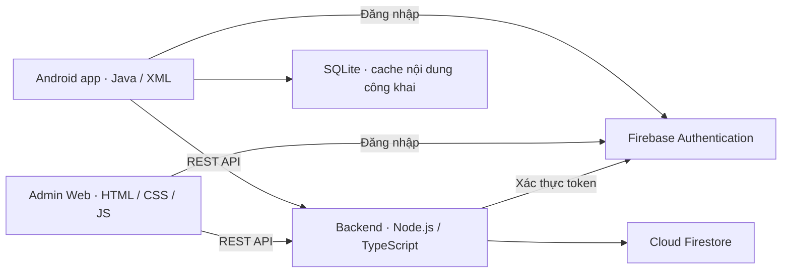

<p align="center">
  
</p>

<p align="center">
  <strong>Ứng dụng Android kết nối cộng đồng sống xanh</strong><br>
  Chia sẻ kiến thức tái chế, tìm cảm hứng tái sử dụng và mua bán đồ đã qua sử dụng.
</p>

<p align="center">
  
  
  
  
  
</p>

<p align="center">
  <a href="#gioi-thieu">Giới thiệu</a> ·
  <a href="#tinh-nang">Tính năng</a> ·
  <a href="#giao-dien">Giao diện</a> ·
  <a href="#kien-truc">Kiến trúc</a> ·
  <a href="#bat-dau">Cách chạy</a> ·
  <a href="#tai-lieu">Tài liệu</a> ·
  <a href="#thanh-vien">Thành viên</a>
</p>

---

<a id="gioi-thieu"></a>

## Một cộng đồng, nhiều vòng đời mới

**EcoShare — Recycling Share App** là đồ án xây dựng một không gian để mọi người chia sẻ kinh nghiệm tái chế, kết nối với nhau và tìm chủ mới cho những món đồ còn giá trị sử dụng.

Hệ thống gồm **ứng dụng Android native**, **API Node.js/TypeScript** và **Admin Web** dùng chung Firebase Authentication và Firestore. Giao diện sử dụng tông xanh, các cụm nội dung bo góc và bố cục thích ứng theo hướng màn hình.

**Bản chạy hiện tại:** backend trên máy tính, Firebase cloud theo gói Spark, Admin Web tại localhost. Cần giữ backend hoạt động để dùng các tính năng dữ liệu của app. Thanh toán MoMo/VNPay là **mô phỏng**, chưa chuyển tiền thật.

<a id="tinh-nang"></a>

## Tính năng chính

| Khu vực | Trải nghiệm |
| --- | --- |
| **Cộng đồng** | Đăng bài chia sẻ và mẹo tái chế; xem story; thích, bình luận, lưu bài và chia sẻ qua tin nhắn. |
| **Khám phá** | Tìm kiếm mẹo hay, thử thách và tin bán; xem nội dung chi tiết, tham gia thử thách Eco. |
| **Bạn bè & tin nhắn** | Gửi/chấp nhận lời mời kết bạn; hội thoại cá nhân, tin nhắn chờ, ảnh đính kèm và nội dung được chia sẻ. |
| **Chợ đồ cũ** | Đăng/sửa tin bán kèm ảnh, giá và tồn kho; kiểm duyệt trước khi công khai; quản lý đơn mua và đơn bán. |
| **Hồ sơ cá nhân** | Cập nhật ảnh đại diện/ảnh bìa, địa chỉ nhận hàng, hồ sơ xác minh, tài khoản nhận tiền và tiến độ điểm Eco. |
| **SCAN** | Chụp hoặc chọn ảnh sản phẩm, lưu và xem lại lịch sử riêng tư. |
| **Thông báo** | Theo dõi tương tác và các cập nhật liên quan đến tài khoản. |
| **Admin trên Android** | Xem tổng quan, duyệt/từ chối tin bán, xử lý báo cáo kèm lý do và quản lý thử thách. |
| **Admin Web** | Quản lý người dùng, xác minh, nội dung, SCAN, tin bán, đơn hàng, bản ghi thanh toán, báo cáo, danh mục, sổ điểm và nhật ký quản trị. |

**Quy tắc mua bán:** người mua và người bán đều cần được xác minh. Người bán phải khai báo tài khoản nhận tiền bằng **ngân hàng hoặc MoMo** trước khi tạo/gửi lại tin bán; backend kiểm tra điều kiện này cả khi duyệt tin. Xem [quy tắc khai báo nhận tiền](docs/payout-account.md).

<details>
<summary><strong>Phạm vi demo cần biết</strong></summary>

- **MoMo/VNPay:** giao diện mô phỏng kết quả thanh toán trên thiết bị; không trừ tiền, chi trả cho người bán hoặc tự đánh dấu đơn đã thanh toán trên máy chủ.
- **Tài khoản nhận tiền:** thông tin tự khai báo, chưa xác minh quyền sở hữu với ngân hàng/MoMo và chưa phải dịch vụ liên kết ví/chi trả.
- **SCAN:** hỗ trợ chụp và lưu ảnh; chưa nhận diện vật liệu bằng AI.
- **Đăng nhập Google:** đã tích hợp luồng đăng nhập, còn cần nghiệm thu bằng tài khoản thật trên thiết bị. Luồng Email/Password là cách chạy demo chính.
- **Offline:** hỗ trợ đọc lại nội dung công khai đã lưu; thao tác ghi và dữ liệu mới vẫn cần kết nối.

</details>

<a id="giao-dien"></a>

## Giao diện thực tế

<table>
  <tr>
    <th width="33%">Cộng đồng sống xanh</th>
    <th width="33%">Thanh toán mô phỏng</th>
    <th width="33%">Quản trị trên Android</th>
  </tr>
  <tr>
    <td align="center"></td>
    <td align="center"></td>
    <td align="center"></td>
  </tr>
</table>

**Không gian quản trị trên web**


<sub>Ảnh chụp ứng dụng thật ngày 29–30/10/2026 trên Firebase Emulator. Tên, số tài khoản và số liệu hiển thị là dữ liệu kiểm thử. [Thông tin ảnh](docs/assets/readme/README.md).</sub>

<a id="kien-truc"></a>

## Kiến trúc & công nghệ



| Thành phần | Công nghệ & vai trò |
| --- | --- |
| **Android** | Java 11, XML, AndroidX, Material Components, OkHttp; min SDK 24, compile/target SDK 37. |
| **Backend** | Node.js 22, TypeScript, Express, Firebase Admin SDK; phân quyền, validation và nghiệp vụ tập trung tại API. |
| **Dữ liệu & xác thực** | Firebase Authentication và Firestore. Chế độ Spark lưu ảnh inline, giới hạn **384 KiB/tệp**, tải qua API có kiểm tra quyền. |
| **Admin Web** | HTML/CSS/JavaScript, chạy bằng static server; không cần build frontend bằng npm. |
| **Lưu trữ trên Android** | SQLite cho nội dung công khai đã xem; `SessionVault` lưu phiên được mã hóa bằng AES-GCM với Android Keystore. |
| **Kiểm thử** | Node Test Runner + Firebase Emulator Suite; JUnit/Espresso trên Android; công cụ kiểm tra mô hình và thiết kế. |

Feed tải theo trang **6 mục**, nạp thêm khi cuộn; client có cache, tải ảnh bất đồng bộ và bỏ phản hồi không còn phù hợp với màn/phiên hiện tại. Xem [tài liệu tải dữ liệu](docs/data-loading.md).

Firestore là nguồn dữ liệu vận hành. `database/schema.sql` là **schema tham chiếu**, không phải cơ sở dữ liệu máy chủ phải cài thêm.

<a id="bat-dau"></a>

## Chạy dự án trên máy

Các lệnh dưới đây dùng **PowerShell**, chạy tại **thư mục gốc repo**.

### 1. Chuẩn bị môi trường

| Công cụ / cấu hình | Yêu cầu |
| --- | --- |
| Android Studio | Cài Android SDK 37, dùng Gradle JDK đi kèm IDE; thiết bị Android API 24 trở lên. |
| Node.js | **22.x**, có `node` và `npm.cmd` trong `PATH`. |
| Python | **3.x**, dùng để mở static server cho Admin Web. |
| Firebase | Có Internet; mỗi thành viên dùng Google account được cấp quyền Auth/Firestore trên project của nhóm. |
| Cấu hình Android | Đặt `google-services.json` đúng project/package vào `app/`; lấy từ người quản lý project hoặc Firebase Console. |

`app/google-services.json` được bỏ qua trong Git. Có file cấu hình này **không đồng nghĩa** có quyền chạy backend. Quyền Google account trên Firebase và vai trò Admin bên trong EcoShare được cấp riêng.

### 2. Cài dependency & đăng nhập Firebase CLI

```powershell
npm.cmd --prefix backend ci
& .\backend\node_modules\.bin\firebase.cmd login
& .\backend\node_modules\.bin\firebase.cmd projects:list
```

Với project hiện tại, danh sách cần có **`recycling-share-app`**. Không cần cài Firebase CLI toàn cục; CLI đã có trong dependency backend. Tài khoản vẫn cần đủ quyền thao tác Auth/Firestore, ngoài việc nhìn thấy project.

### 3. Bật backend — terminal thứ nhất

```powershell
$env:GCLOUD_PROJECT='recycling-share-app'
$env:PORT='5002'
$env:ECOSHARE_MEDIA_BACKEND='firestore'
$env:FIRESTORE_EMULATOR_HOST=$null
$env:FIREBASE_AUTH_EMULATOR_HOST=$null
$env:FIREBASE_STORAGE_EMULATOR_HOST=$null
npm.cmd --prefix backend run dev:cloud
```

Giữ terminal này mở. Script tự build TypeScript và khởi động API tại **`http://127.0.0.1:5002/v1`**. Kiểm tra trong terminal khác:

```powershell
Invoke-RestMethod http://127.0.0.1:5002/v1/health
```

Chế độ phát triển này dùng Firebase cloud với backend local, không yêu cầu triển khai Cloud Functions hoặc nâng gói Blaze. Khi tắt backend, app không thể thực hiện các thao tác cần API. Hướng dẫn lỗi cấu hình/quyền: [Backend README](backend/README.md).

### 4. Mở Admin Web — terminal thứ hai

```powershell
$env:GCLOUD_PROJECT='recycling-share-app'
node admin-web/scripts/configure-firebase.mjs --local-cloud
python -m http.server 5173 --directory admin-web --bind 127.0.0.1
```

Mở **[http://127.0.0.1:5173/](http://127.0.0.1:5173/)** và đăng nhập bằng tài khoản có vai trò **Admin** trong EcoShare. Script tạo cấu hình local cho web. Xem [hướng dẫn Admin Web](admin-web/README.md) nếu cần thiết lập tài khoản hoặc đổi môi trường.

### 5. Chạy ứng dụng Android

Mở **thư mục gốc repo** bằng Android Studio, đồng bộ Gradle, chọn module `app` và Run trên Android Emulator. Bản debug của project hiện tại tự kết nối API máy tính qua **`10.0.2.2:5002`**.

Để chỉ build APK bằng terminal, cần đặt `JAVA_HOME` hoặc `java` trong `PATH` trỏ đến JDK/JBR phù hợp với Gradle (có thể dùng JBR đi kèm Android Studio):

```powershell
.\gradlew.bat :app:assembleDebug
```

APK nằm tại `app/build/outputs/apk/debug/app-debug.apk`. Cách cấu hình cho điện thoại thật và Firebase Emulator riêng nằm trong [hướng dẫn Android](docs/android-firebase.md).

## Cấu trúc repository

```text
RecyclingShareApp/
├── app/                         # Ứng dụng Android native & kiểm thử
│   └── src/main/
│       ├── java/.../            # Điều hướng, UI, API client, cache, model
│       └── res/                 # Layout XML, theme, icon, tiếng Việt
├── backend/                     # REST API TypeScript, nghiệp vụ & test
├── admin-web/                   # Giao diện quản trị HTML/CSS/JS
├── database/                    # Schema SQL tham chiếu
├── docs/                        # Hướng dẫn, kiểm toán, API & ảnh README
├── tools/                       # Công cụ kiểm tra/sinh mô hình và sơ đồ
├── Recycling Share App/
│   ├── src/                     # Bản thiết kế React gốc để tham khảo
│   └── diagrams-current/        # Class, ERD, Function & lớp Android
├── firebase.json                # Cấu hình Firebase / Emulator
├── firestore.rules              # Quy tắc truy cập Firestore
└── firestore.indexes.json       # Chỉ mục truy vấn
```

## Kiểm thử & chất lượng

| Lượt kiểm tra | Kết quả đã ghi nhận |
| --- | --- |
| Backend, ngày **30/10/2026** | **159/159** ca, 13 suite, không lỗi hoặc bỏ qua; chạy với Firebase Emulator. [Chi tiết bản sửa tìm kiếm](docs/explore-search-fix.md). |
| Android, ngày **30/10/2026** | **4/4** ca `ReportEvidenceUiTest`: quản trị, khai báo nhận tiền, thanh toán demo và đọc cache khi API bị ngắt. Đây là lượt kiểm tra tập trung, không phải chạy lại toàn bộ instrumentation. |

Các lệnh để chạy lại từng nhóm kiểm tra:

```powershell
# Backend: script tự quản lý Firebase Emulator; cần Java 21+ trên PATH
npm.cmd --prefix backend run test:emulators

# Kiểm thử JVM của Android
.\gradlew.bat :app:testDebugUnitTest

# Đối chiếu mô hình và thiết kế
python tools/validate_design.py
```

Kiểm thử tích hợp dùng project **`demo-recycling-share`**, tách với dữ liệu cloud của nhóm. Xem [lịch sử kiểm thử](docs/verification.md), [kiểm tra khai báo nhận tiền](docs/payout-account.md#kiểm-tra) và [mã kiểm thử UI tập trung](app/src/androidTest/java/com/example/recyclingshareapp/ReportEvidenceUiTest.java) để biết điều kiện và phạm vi từng lượt.

<a id="tai-lieu"></a>

## Tài liệu & sơ đồ

| Nội dung | Tài liệu |
| --- | --- |
| Thiết lập dự án | [Backend](backend/README.md) · [Admin Web](admin-web/README.md) · [Android & Firebase](docs/android-firebase.md) |
| API & dữ liệu | [REST API v1](docs/firebase-api.md) · [Mô hình nghiệp vụ](docs/domain-model.json) · [Đối chiếu Firestore](docs/firestore-physical-map.md) |
| Giao dịch | [Thanh toán demo](docs/payments-firebase.md) · [Tài khoản nhận tiền](docs/payout-account.md) |
| Chất lượng & vận hành | [Tải dữ liệu](docs/data-loading.md) · [Sửa tìm kiếm 30/10](docs/explore-search-fix.md) · [Rà soát hệ thống 23/10](docs/system-audit-2026-10-23.md) |
| Phân công nhóm | [Phân chia công việc cho 5 thành viên](docs/phan-cong-github-5-thanh-vien.md) |

**Sơ đồ phạm vi Android/Admin Web** — bản ngày 27/10/2026:

| Sơ đồ | Bản xem |
| --- | --- |
| Class Diagram — thực thể nghiệp vụ | [SVG](<Recycling Share App/diagrams-current/class-diagram.svg>) |
| Class Diagram — các lớp Android chính | [SVG](<Recycling Share App/diagrams-current/runtime-class-diagram.svg>) |
| ERD logic | [SVG](<Recycling Share App/diagrams-current/erd.svg>) |
| Function Diagram | [SVG](<Recycling Share App/diagrams-current/function-diagram.svg>) |

[Tải bộ sơ đồ ZIP](<Recycling Share App/diagrams-current/ecoshare-diagrams-current.zip>) · [Phạm vi và cách cập nhật](<Recycling Share App/diagrams-current/README.md>). Có bản Mermaid, draw.io và PNG để chỉnh sửa hoặc đưa vào báo cáo.

<a id="thanh-vien"></a>

## Nhóm thực hiện

| Thành viên | MSSV | GitHub |
| --- | --- | --- |
| Lê Dương Anh Khoa | 31241020839 | [KhoaLe-net17](https://github.com/KhoaLe-net17) |
| Võ Hoàng Tuấn Hải | 31241027049 | [tuanHai-IT](https://github.com/tuanHai-IT) |
| Lý Minh Đạt | 31241022041 | [AnhDatGiaSu2006](https://github.com/AnhDatGiaSu2006) |
| Nguyễn Đức Trung | 31241021311 | [DuckkkTrung](https://github.com/DuckkkTrung) |
| Võ Trọng Hoài Nghĩa | 31241023337 | [vonghiavn](https://github.com/vonghiavn) |

---

<p align="center">
  <strong>Chia sẻ hôm nay — Xanh hơn mỗi ngày.</strong><br>
  <sub>EcoShare · Đồ án nhóm 9 · Nội dung README cập nhật ngày 30/10/2026</sub>
</p>
